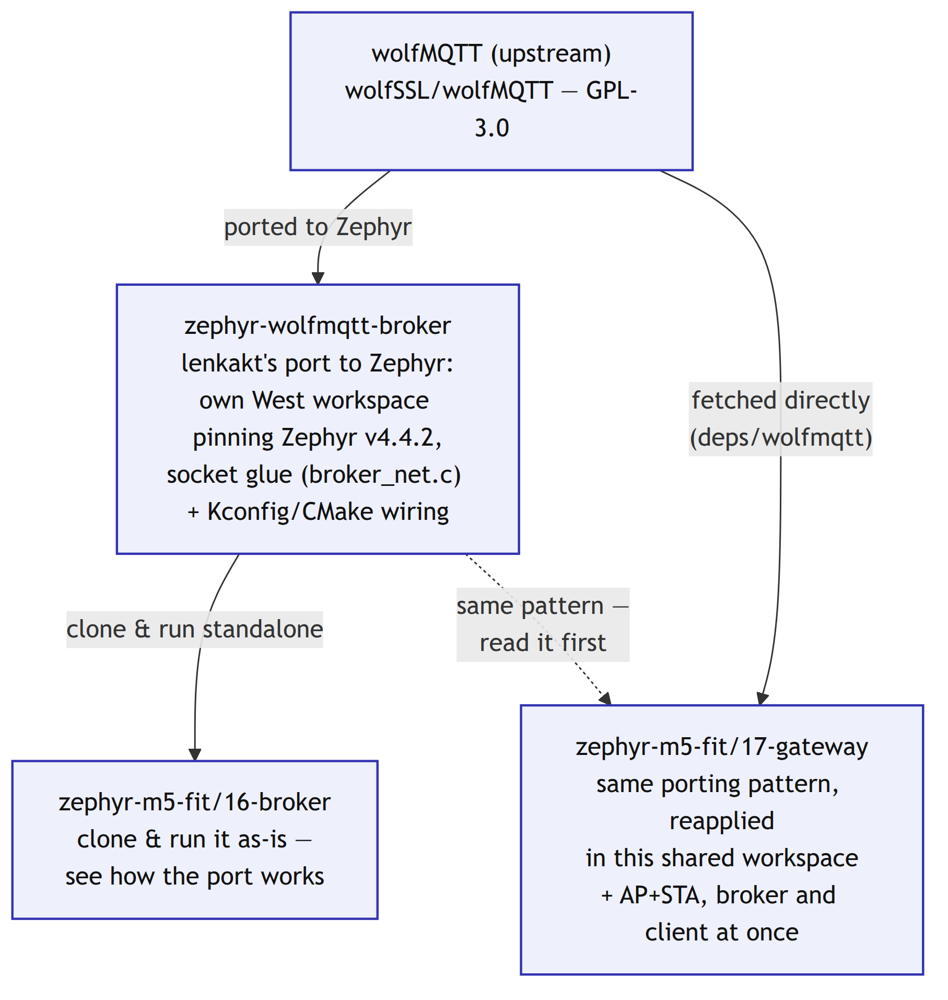

# 16-broker — running your own MQTT broker on hardware

Not a buildable app in *this* workspace — a pointer to a separate
project: **[zephyr-wolfmqtt-broker](https://github.com/lenkakt/zephyr-wolfmqtt-broker)**,
which runs the [wolfMQTT](https://github.com/wolfSSL/wolfMQTT) broker on
Zephyr. It's been tested on `native_sim` and on an M5Stack Fire over
Wi-Fi with 10 clients.



(Source: `diagrams/relationship.mmd`. Same diagram as
[`17-gateway`](../17-gateway) — see there if you want the
broker-and-client-at-once example instead of just the broker.)

## Why this isn't just another numbered app here

Every other example in this repo (`01-hello` through `15-mqtt`) is a
standalone app that points at whichever Zephyr checkout you already
have via `ZEPHYR_BASE` — none of them need their own `west init`.
`zephyr-wolfmqtt-broker` is different on purpose: it's its own West
workspace, with its own `west.yml` manifest pinning a specific Zephyr
version (4.4.2) and a specific wolfMQTT version (v2.2.0). It can't be
dropped in here and built with `west build -d build 16-broker` the way
the others can — it lives in, and needs, its own workspace.

There's also a licensing reason it stays a separate repo rather than
getting vendored in as source: wolfMQTT is GPL-3.0, and this repo is
Apache-2.0. Keeping the broker in its own repository, under its own
licence, avoids mixing the two.

## How this relates to `15-mqtt` and the week 7 lab

`15-mqtt` and the week 7 lab assignment both talk to an **external**
broker — Mosquitto, provided for you in the lab session. This example
is for anyone who wants to run their *own* broker instead: to test
`15-mqtt` at home with no access to the course broker, to point two
M5stack Fires at a third one acting as the broker, or just out of
curiosity about what's actually listening on the other end of that
connection. It's optional and exploratory — nothing in the graded lab
needs it.

## Setting it up

Full instructions, memory figures, and licensing are in the repo's own
README; this is the short version. Start in a new, empty folder (this
is a separate workspace, not something you set up inside
`zephyr-m5-fit`):

```sh
mkdir broker-workspace && cd broker-workspace
git clone https://github.com/lenkakt/zephyr-wolfmqtt-broker
west init -l zephyr-wolfmqtt-broker
west update
west blobs fetch hal_espressif
```

Quickest way to try it, on Linux, no hardware needed:

```sh
west build -p always -b native_sim/native/64 -d build-sim zephyr-wolfmqtt-broker
build-sim/zephyr/zephyr.exe
```

```sh
mosquitto_pub -h 127.0.0.1 -t "test" -m "hello" -q 1
mosquitto_sub -h 127.0.0.1 -t "test" -v
```

On an M5Stack Fire instead (needs a Wi-Fi network that lets devices
talk to each other — guest/university networks often block this):

```sh
cp zephyr-wolfmqtt-broker/wifi.local.conf.example zephyr-wolfmqtt-broker/wifi.local.conf
# edit wifi.local.conf: your network name and password

west build -p always -b m5stack_fire/esp32/procpu -d build-fire zephyr-wolfmqtt-broker
west flash -d build-fire --esp-device /dev/ttyACM0
python -m serial.tools.miniterm /dev/ttyACM0 115200
```

The board prints `board address: ...` once it's up. Point `15-mqtt`'s
(or `solutions/07-mqtt`'s) `BROKER_HOST` at that address, from a second
board on the same network, to talk to a broker you're running yourself
instead of the course's Mosquitto.
