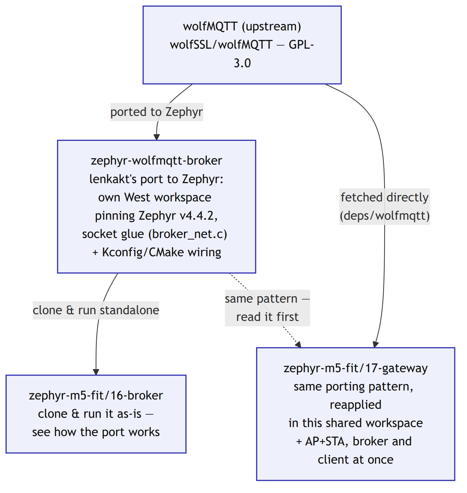
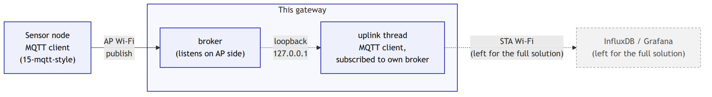

# 17-gateway — dual Wi-Fi, broker and client at once

A template for the final-assignment "gateway" device: it hosts the
sensor node's own Wi-Fi network and, separately, joins a second
network that has internet access (for InfluxDB/Grafana) - and it's
both an MQTT broker (for the sensor) and an MQTT client (for itself)
at the same time. This is **not the full solution** - it only
demonstrates those two mechanisms. The sensor-reads-affect-sensor
logic, and actually forwarding readings to InfluxDB/Grafana, are left
for the real assignment.

Verified: builds clean against this workspace's `~/zephyrproject`
(pinned to the same Zephyr `v4.4.2` this example's wolfMQTT dependency
was tested against - see below), zero warnings, both a plain and a
pristine (`-p always`) build.

## Licensing — read this before using any of this code

Every other example in this repo is Apache-2.0, like the repo itself.
**This one isn't.** It links [wolfMQTT](https://github.com/wolfSSL/wolfMQTT)
to get an MQTT broker, and wolfMQTT is GPL-3.0-or-later - a binary that
links it is a combined work under that same license, regardless of
what any individual source file here says. So every new file under
`17-gateway/` carries a `GPL-3.0-or-later` SPDX header instead of
`Apache-2.0`, matching what the separate
[zephyr-wolfmqtt-broker](https://github.com/lenkakt/zephyr-wolfmqtt-broker)
repo already does for the same reason. If you'd rather this repo stay
entirely Apache-2.0, the alternative is keeping this example out of it
entirely (the way `16-broker` stayed a pointer-only README) - that's a
call worth making deliberately, not by accident.

## Read the port first

Before you fetch wolfMQTT for this app, clone and skim
**[zephyr-wolfmqtt-broker](https://github.com/lenkakt/zephyr-wolfmqtt-broker)**
(the same repo [`16-broker`](../16-broker) points at). It's a complete,
working port of wolfMQTT onto Zephyr, and this example's own
`src/broker_net.c` and `CMakeLists.txt` follow the exact same pattern
it does - reading it first is reading the pattern once, properly
explained, instead of reverse-engineering it from this app alone.
Specifically worth reading there:

- `src/broker_net.c` - the `MqttBrokerNet` socket glue (listen/accept/
  read/write/close via Zephyr's `zsock_*` calls). `17-gateway/src/broker_net.c`
  is the same five callbacks, independently written but structurally
  identical.
- `CMakeLists.txt`'s comment about "a manual copy, for workspaces
  where west doesn't provide wolfMQTT" - that's the exact mechanism
  `17-gateway/CMakeLists.txt` uses below, just the other way around
  (their repo supports it as a fallback; this one relies on it, since
  this shared workspace's `west` manifest can't gain a new dependency
  just for one example).
- `src/user_settings.h` - why the broker's buffer/client limits need
  trimming down at all on an ESP32 (RAM).



(Source: `diagrams/relationship.mmd` - same diagram as
[`16-broker`](../16-broker)'s README.)

## Get the broker library

wolfMQTT isn't part of this workspace's shared `west` manifest (that
manifest is shared with every other example here, and with
`zephyr4squirrels` - it doesn't get a new dependency just for this one
app). Fetch it locally instead, into a `deps/` folder that's
gitignored and never committed:

```sh
cd 17-gateway
git clone --branch v2.2.0 https://github.com/wolfSSL/wolfMQTT.git deps/wolfmqtt
```

`CMakeLists.txt` picks it up automatically if `deps/wolfmqtt` exists
(the same "manual copy" mechanism wolfMQTT's own Zephyr module docs
describe, and that `zephyr-wolfmqtt-broker`'s `CMakeLists.txt` already
has a comment anticipating). Without it, the build fails with missing
`wolfmqtt/mqtt_broker.h` errors.

## Architecture



(Source: `diagrams/architecture.mmd`, rendered with
[mermaid-cli](https://github.com/mermaid-js/mermaid-cli) — same
pipeline as the diagrams in `fit-iot/slides`. Re-render after editing
with `mmdc -i architecture.mmd -o ../architecture.png -b white -s 3`
from `diagrams/`.)

- **`src/wifi.c`** — `wifi_ap_enable()` brings up the AP interface
  (`net_if_get_wifi_sap()`), with its own DHCPv4 server, so the sensor
  node has somewhere to join with no existing router needed.
  `wifi_sta_connect()` is the uplink - exactly `07-wifi`/`08-http`/
  `15-mqtt`'s credential-shell pattern (`wifi cred add`, never
  hardcoded), unchanged.
- **`src/main.c`** — calls `wifi_ap_enable()` first (required for the
  ESP32 driver to settle into AP+STA combo mode rather than switching
  between the two - see "Why the AP side doesn't wait for anything"
  below), then `wifi_sta_connect()`, then runs the broker
  (`MqttBroker_Init`/`MqttBroker_Run`, blocking, same as
  `zephyr-wolfmqtt-broker`'s own `main.c`).
- **`src/broker_net.c`** — Zephyr/zsock glue for the broker's
  `MqttBrokerNet` callbacks. Binds `0.0.0.0`, so it's reachable from
  whichever boards join the AP.
- **`src/uplink.c`** + **`src/client_net.c`** — the "also a client"
  half: a `K_THREAD_DEFINE`'d thread running an ordinary wolfMQTT
  *client*, connecting to `127.0.0.1:1883` (this device's own broker,
  over loopback) and subscribing to `CONFIG_APP_UPLINK_TOPIC_FILTER`.
  There's no other way to do this - the broker library has no
  app-level "notify me when something is published" hook, so a plain
  client subscribing like anyone else is what "the broker also
  subscribes" has to mean.

## Why the AP side doesn't wait for anything

`wifi_ap_enable()` and the broker start unconditionally, with no
dependency on the uplink Wi-Fi ever connecting. That's deliberate: the
sensor node and this gateway need to keep talking over MQTT even with
no internet connection at all - "the gateway is also a broker in case
we have no external connection, to keep the system alive." The uplink
is best-effort on top of that, not a precondition for it.

## What this template deliberately doesn't do

- Doesn't forward anything the uplink thread receives to InfluxDB or
  anywhere else - `src/uplink.c`'s `forward_reading()` just logs it.
  That's the real assignment's job.
- Doesn't implement the sensor-A-affects-sensor-B command logic.
- Doesn't handle broker/uplink reconnection beyond what's needed for
  the demo to keep running (the uplink thread does reconnect if the
  broker connection drops; nothing here deals with the *sensor's* own
  reconnection logic).

## Build

```sh
source ~/zephyrproject/.venv/bin/activate
export ZEPHYR_BASE=~/zephyrproject/zephyr
west build -b m5stack_fire/esp32/procpu -d build 17-gateway
```

## Flash

```sh
west flash
```

(Port autodetection should work; use `--esp-device /dev/ttyACM0` if
not - see the top-level README.)

## Verify

Over the shell (`picocom -b 115200 /dev/ttyACM0`):

- Optionally provision the uplink credential: `wifi cred add -s "..."
  -k 1 -p "..."`, then reset. Without one, you'll see a warning in the
  log, and the AP/broker side keeps working anyway.
- Watch the log for `AP up: fit-iot-gateway on 192.168.4.1` and
  `uplink: subscribed to '+/sensor' on our own broker`.
- Point `15-mqtt` (or any MQTT client) at `192.168.4.1:1883` after
  joining the `fit-iot-gateway` Wi-Fi network, and publish to a topic
  matching `+/sensor` (e.g. `temp/sensor`). You should see `uplink:
  received on 'temp/sensor': ...` in this board's log.
